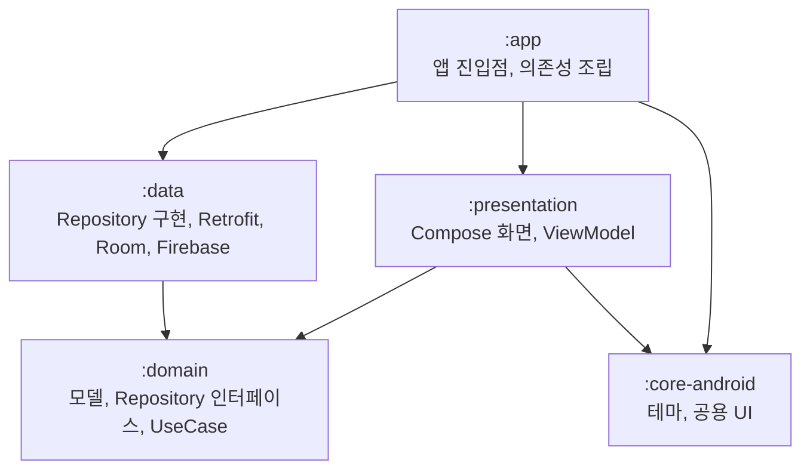

# 더 무비 (The Movie)

영화 정보를 확인하고, 관람한 영화의 감상문을 사진과 함께 기록하며, 가까운 영화관을 찾을 수 있는 안드로이드 앱입니다. XML과 MVVM으로 만든 처음 버전(`v0.1.0-legacy`)을 Jetpack Compose, MVI, 클린 아키텍처로 리팩터링하고 기능을 고도화하고 있습니다.

## 주요 기능

| 기능       | 내용                                                   |
| -------- | ---------------------------------------------------- |
| 🔐 인증    | 회원가입, 로그인, 로그아웃                                      |
| 🎬 영화    | 무한 스크롤로 보는 인기 영화, 높은 평점 영화, 영화 검색                    |
| 🎞 영화 상세 | 개봉일, 평점, 출연진, 줄거리 확인과 예고편 재생                         |
| 🖊 감상문   | 사진을 포함한 감상문 작성, 수정, 삭제, 계정별 서버 백업(네트워크가 연결되면 자동 업로드) |
| 📍 영화관   | 현재 위치 주변 영화관 지도 표시, 카카오맵 길찾기 연동                      |
| 🔔 알림    | 푸시 알림 수신                                             |

## 실행 화면

| 로그인 | 영화 목록 | 영화 검색 | 영화 상세 |
| :---: | :---: | :---: | :---: |
|  |  |  |  |

| 감상문 | 영화관 지도 | 알림 |
| :---: | :---: | :---: |
|  |  |  |

## 기술 스택

| 분류           | 사용 기술                                                                           |
| ------------ | ------------------------------------------------------------------------------- |
| Language     | Kotlin                                                                          |
| UI           | Jetpack Compose, Material3, Navigation Compose                                  |
| Architecture | 클린 아키텍처, MVI, 멀티모듈                                                              |
| DI           | Hilt                                                                            |
| Async        | Coroutines, Flow                                                                |
| Paging       | Paging 3 (paging-compose)                                                       |
| Network      | Retrofit, OkHttp, kotlinx.serialization                                         |
| Local        | Room, DataStore                                                                 |
| Background   | WorkManager                                                                     |
| Image        | Coil                                                                            |
| Media        | android-youtube-player                                                          |
| Location     | Play Services Location (FusedLocationProvider)                                  |
| Firebase     | Authentication, Realtime Database, Storage, Cloud Messaging                     |
| 외부 API / SDK | TMDB API, Kakao Local API, Kakao Map SDK                                        |
| Build        | Version Catalog, Convention Plugin                                              |
| Quality      | ktlint, detekt, Android Lint, JUnit, Robolectric, MockWebServer, GitHub Actions |

## 아키텍처

클린 아키텍처를 바탕으로 Presentation, Domain, Data 계층을 각각 모듈로 분리했습니다.



- `:domain`은 Android 코드 없이 Kotlin만으로 작성해, 화면이나 기기 없이도 JVM 테스트로 규칙을 확인할 수 있게 했습니다.
- `:presentation`이 `:data`를 모르도록 나눠, 데이터 출처를 바꿔도(예: Firebase에서 REST 서버로) 화면 코드는 고치지 않아도 되게 했습니다.
- 화면마다 `Contract`에 `UiState`, `Intent`, `Effect`를 두는 MVI 구조입니다. 상태는 `StateFlow`로, 토스트나 화면 이동 같은 일회성 이벤트는 `Channel`로 전달합니다.
- 영화 목록과 검색 결과는 로딩과 오류 상태를 Paging이 직접 관리하므로, 같은 상태를 두 곳에서 다루지 않도록 `UiState`에 넣지 않고 `PagingData`로 따로 내보냅니다.

## 기술적 고민과 문제 해결

### 1. 오프라인에서 바꾼 감상문이 서버에 반영되지 않아 유실되거나 되살아나는 문제

**문제**

오프라인 상태에서 감상문을 저장하거나 수정한 뒤 로그아웃하고 다시 로그인하면, 그 감상문이 서버에 백업되지 않아 유실되는 문제가 있었습니다. 또한 오프라인 상태에서 지운 감상문이, 앱을 종료한 뒤 온라인 상태에서 다시 열면 목록에 다시 나타나는 경우도 있었습니다.

**원인**

감상문은 Room에 먼저 저장하고 Firebase Realtime Database에 백업합니다. 그런데 서버에 저장·삭제 요청을 보내기만 하고 그 요청이 서버에 반영됐는지 확인하지 않아, 요청이 서버에 전달되지 않거나 서버가 거부해도 앱은 알 수 없었습니다. 또한 아직 보내지 못한 요청은 Firebase SDK의 메모리에만 있어 앱이 종료되면 사라졌고, 실패한 변경을 다시 보내는 장치도 없었습니다.

- 저장: 서버에 백업되지 않은 감상문은 기기(Room)에만 남았고, 로그아웃할 때 Room의 감상문을 모두 지우므로 함께 사라졌습니다.
- 삭제: Room 행을 먼저 지운 뒤 서버 삭제를 요청했기 때문에, 서버 삭제가 실패하면 감상문이 서버에만 남았고 목록 동기화가 이를 Room에 없는 새 감상문으로 보고 다시 추가했습니다.

**해결 ① 동기화 상태와 WorkManager 업로드 큐 추가**

- 감상문마다 동기화 상태(`syncState`)를 두었습니다. 서버에 반영됐으면 `SYNCED`, 저장을 올려야 하면 `PENDING_UPSERT`, 삭제를 반영해야 하면 `PENDING_DELETE` 상태입니다.
- 감상문 저장과 삭제 시 Room에 대기 상태를 기록하고 WorkManager에 업로드 작업을 예약합니다. 대기 중인 저장과 삭제를 Realtime Database에 반영하는 일은 이 업로드 작업에서 처리합니다. (사진은 예외입니다. 감상문에는 사진 URL을 담는데 이 URL은 Storage 업로드가 끝나야 생기므로, 사진이 있으면 저장 화면에서 Storage 업로드를 먼저 마친 뒤 Room에 기록합니다. 그래서 사진이 있는 감상문은 온라인에서만 저장할 수 있습니다.)
- 감상문 목록을 열면 서버 감상문 중 Room에 없는 것을 받아 오는 동기화를 한 번 하고, 동기화가 끝난 뒤 아직 올리지 못한 감상문이 남아 있으면 업로드 작업을 다시 예약합니다. (보안 규칙이 거부한 감상문은 업로드 작업이 끝난 뒤에도 대기 상태로 남는데, 다른 감상문을 저장하거나 지우기 전까지는 다시 예약되지 않습니다. 그래서 규칙이나 앱을 고친 뒤 목록을 열면 올라가도록 했습니다.) 예약한 작업은 네트워크가 연결되면 실행돼 대기 중인 감상문을 오래된 변경부터 올립니다. 앱이 종료되거나 기기를 재부팅해도 예약은 남아 있어, 앱을 다시 열지 않아도 연결되면 올라갑니다.
- `PENDING_DELETE` 상태인 감상문은 목록에서 숨기기만 하고, 업로드 작업이 서버에서 지운 뒤에야 Room에서 지웁니다. 그래서 그 전에 동기화가 돌아도 같은 id의 행이 남아 있어 서버 감상문을 다시 추가하지 않습니다. 다만 동기화가 서버 목록을 읽은 직후 업로드 작업이 서버와 Room에서 감상문을 지우면, 동기화는 이미 읽은 목록으로 지운 감상문을 다시 넣습니다. 그래서 동기화의 서버 읽기부터 Room 추가까지와 업로드 작업의 삭제를 같은 `Mutex`로 잠가, 한쪽이 끝나야 다른 쪽이 실행되게 했습니다.
- Firebase 디스크 저장(`setPersistenceEnabled`)을 켜도 보내지 못한 요청이 기기에 남아 다시 전송되지만, 앱을 다시 열어 Firebase가 연결돼야 보내집니다. 또 대기 중인 요청을 조회하는 API가 없고 앱을 다시 시작하면 이전 요청의 완료 콜백도 사라져, 로그아웃할 때 올리지 않은 변경이 있는지 안내할 수 없습니다. 재전송도 Firebase SDK에 묶여 있어 나중에 REST 서버로 옮기면 그대로 쓸 수 없으므로 큐를 직접 만들었습니다.

**해결 ② 감상문을 서버에 올리는 동안의 수정·삭제와 응답 없는 서버 처리**

```kotlin
@Query(
    "UPDATE reviewTable SET syncState = 'SYNCED' " +
        "WHERE id = :id AND localVersion = :localVersion AND syncState = 'PENDING_UPSERT'",
)
suspend fun markSynced(id: String, localVersion: Int): Int
```

- 업로드 작업이 감상문을 서버에 올리는 동안 사용자가 같은 감상문을 다시 고치거나 지울 수 있습니다. 저장할 때마다 `localVersion`을 1씩 올리고, 서버 쓰기가 끝나면 올린 버전과 같고 아직 `PENDING_UPSERT`일 때만 `SYNCED`로 바꿔 그 사이의 변경이 올라가지 않은 채 덮이지 않게 했습니다. 행 삭제도 `PENDING_DELETE`일 때만 합니다.
- Realtime Database는 서버가 응답하지 않으면 실패하지 않고 계속 기다립니다. 응답 없는 요청 하나에 업로드 작업이 묶이면 WorkManager 실행 한도인 10분이 지나야 작업이 멈춰, 그동안 연결이 회복돼도 다시 시도하지 못합니다. 또 업로드 작업은 삭제를 `Mutex`로 잠근 채 실행하므로, 삭제 요청이 멈추면 감상문 목록을 열 때의 동기화도 함께 막힙니다. 그래서 서버 쓰기와 삭제는 30초까지만 기다린 뒤 이번 업로드 작업을 멈추고 WorkManager가 다시 실행하게 했습니다.
- 네트워크 오류와 시간 초과는 감상문 내용이 아니라 연결 상태 때문에 생기므로, 남은 감상문을 하나씩 기다리며 시도하지 않고 이번 업로드를 멈춥니다. 반대로 보안 규칙이 거부한 감상문은 다시 보내도 같은 결과라 그 감상문만 대기 상태로 두고 나머지를 계속 올립니다.

**검증**

- 자동 테스트(Firebase는 가짜 구현으로 대체)
  - Room 쿼리: 실제 Room(Robolectric)으로 서버에 올리는 동안 다시 수정하거나 삭제 표시한 감상문이 `SYNCED`로 바뀌지 않는지 확인했습니다.
  - 업로더: 서버에 올리는 동안의 수정·삭제, 네트워크 오류, 30초 무응답, 권한 거부마다 어떤 감상문이 대기 상태로 남는지 확인했습니다.
  - 동기화와 삭제 순서: 목록 동기화가 서버 목록을 읽는 도중에 업로드 작업이 같은 감상문을 지워도, 그 감상문이 목록에 다시 나타나지 않는지 확인했습니다.
- 에뮬레이터: 네트워크를 끊고 저장한 뒤 앱 프로세스를 종료하거나 기기를 재부팅해도 연결되면 앱을 열지 않은 채 서버에 올라가는지, 서버에 올리는 동안 다시 수정하면 마지막 내용이 서버에 남는지 확인했습니다.

한 계정을 한 번에 한 기기에서 쓴다는 전제입니다. 다른 기기에서 바꾼 내용을 받아 오는 서버 기준 동기화는 아직 지원하지 않습니다.

### 2. 무한 스크롤에서 같은 영화가 다시 내려오는 문제

**문제**

TMDB 인기 영화 1~20페이지를 직접 받아 보니 400건 중 35건이 앞 페이지에 이미 나온 영화였습니다. 영화 그리드는 영화 id를 항목 key로 쓰는데, Compose Lazy 그리드는 같은 key를 가진 항목이 함께 그려지면 예외를 던져 앱이 종료됩니다.

**원인**

TMDB 목록은 페이지마다 따로 요청하므로, 요청 사이에 순위가 바뀌면 앞 페이지의 영화가 다음 페이지에 다시 나올 수 있습니다. 서버 응답을 고칠 수 없으니 받는 쪽에서 걸러야 했습니다.

**해결**

```kotlin
private val loadedIds = mutableSetOf<Int>()

private tailrec suspend fun loadFrom(page: Int): LoadResult<Int, Movie> =
    when (val result = loadPage(page)) {
        is Outcome.Failure -> LoadResult.Error(RemoteErrorException(result.error))
        is Outcome.Success -> {
            val movies = result.data.movies.filter { loadedIds.add(it.id) }
            val nextKey = (page + 1).takeIf { page < result.data.totalPages }
            if (movies.isEmpty() && nextKey != null) {
                loadFrom(nextKey)
            } else {
                LoadResult.Page(data = movies, prevKey = ..., nextKey = nextKey)
            }
        }
    }
```

- `MoviePagingSource`가 받은 영화 id를 기억해 다음 페이지에서 뺍니다.
- 한 페이지가 전부 중복이면 빈 페이지가 됩니다. 화면에 새 항목이 없으면 다음 페이지를 부를 계기가 없어 스크롤이 그 자리에서 멈추므로, 같은 로드 안에서 다음 페이지를 이어 받습니다.
- 오래된 페이지를 메모리에서 버리는 `PagingConfig.maxSize`는 쓰지 않았습니다. 버린 페이지를 다시 받으면 이미 받은 id라 모두 걸러져 빈 페이지가 되기 때문입니다. 목록은 최대 20페이지(400건)라 메모리 부담도 크지 않습니다.

**검증**

앞 페이지의 영화가 다음 페이지에 다시 오면 빠지는지, 한 페이지가 전부 중복이면 다음 페이지를 이어 받는지, 마지막 페이지가 전부 중복이면 빈 목록으로 끝나는지 단위 테스트로 확인했습니다.

### 3. 네트워크 요청이 실패하면 앱이 종료되고 원인도 알 수 없는 문제

**문제**

처음 버전에서는 영화 정보나 영화관 검색 요청이 실패했을 때 세 가지 문제가 있었습니다.

- 요청 하나만 실패해도 앱이 종료됐습니다.
- 시간 초과, 인터넷 연결 끊김, 서버 오류를 구분하지 않아 원인에 맞는 안내를 할 수 없었습니다.
- 서버가 잠깐 503(Service Unavailable, 일시적인 서비스 불가)을 보내도 다시 시도하지 않아 요청이 곧바로 실패했습니다.

**원인**

Retrofit 호출을 `viewModelScope.launch` 안에서 예외 처리 없이 실행해, 요청이 실패하면 예외가 그대로 올라가 앱이 종료됐습니다. 예외를 받아 종류를 나누는 계층도 없었고, OkHttp 기본 설정은 연결 실패와 408만 한 번 다시 보내고 5xx 응답은 그대로 돌려주므로 일시적인 서버 오류도 곧바로 실패로 끝났습니다.

**해결 ① `SafeApiCall`로 오류 종류 구분**

```kotlin
internal suspend fun <T> safeApiCall(block: suspend () -> T): DataResult<T> =
    try {
        Outcome.Success(block())
    } catch (e: CancellationException) {
        throw e
    } catch (_: SocketTimeoutException) {
        Outcome.Failure(RemoteError.Timeout)
    } catch (_: IOException) {
        Outcome.Failure(RemoteError.Network)
    } catch (e: HttpException) {
        Outcome.Failure(RemoteError.Http(e.code()))
    } ...
```

- 예외를 `Timeout`, `Network`, `Http(code)` 등으로 구분해 결과 타입으로 반환합니다. 화면은 이 오류를 `remoteErrorMessage`로 "네트워크에 연결되지 않았습니다.", "응답 시간이 초과되었습니다." 같은 안내로 바꿔 보여 주고, 목록을 불러오지 못하면 다시 시도 버튼을 함께 보여 줍니다.
- `CancellationException`은 실패로 바꾸지 않고 다시 던집니다. 실패로 바꾸면 화면을 벗어나 코루틴이 취소된 뒤에도 이후 코드가 계속 실행되기 때문입니다.

**해결 ② `RetryInterceptor`로 일시적 오류만 재시도**

| 기준            | 내용                                                    | 이유                                                                          |
| ------------- | ----------------------------------------------------- | --------------------------------------------------------------------------- |
| 대상 메서드        | `GET`, `HEAD`만                                        | POST 요청은 응답을 받지 못해도 서버에 이미 반영됐을 수 있어, 재전송하면 중복 처리될 수 있음                     |
| 대상 응답         | 408, 429, 500, 502, 503, 504                          | 잠시 후 회복될 수 있는 오류만 재시도 (Retry-After 없는 408은 OkHttp가 먼저 한 번 다시 보내므로, 그 뒤에 적용) |
| 간격            | 1초, 2초 지수 백오프 + 0~0.5초 무작위 지연, 최대 2회 재시도(총 3번 요청)     | 재시도 요청이 한꺼번에 몰리지 않도록                                                        |
| `Retry-After` | 5초 이내면 그 시간만큼 기다려 재시도, 5초를 넘거나 날짜 형식이면 재시도하지 않고 응답 반환 | 오래 기다리는 동안 로딩이 지나치게 길어지지 않도록                                                |
| 취소            | 대기 전후로 취소 여부 확인                                       | 화면을 벗어난 뒤에도 재요청이 이어지지 않도록                                                   |

**검증**

예외 종류별로 알맞은 실패 타입을 반환하는지, 취소 예외는 실패로 바꾸지 않고 다시 던지는지 단위 테스트로 확인했습니다. 재시도 대상 메서드와 응답 코드, 1초·2초 간격, `Retry-After` 처리, 재시도 횟수 초과, 대기 중 취소는 MockWebServer(테스트용 로컬 HTTP 서버)에 정해 둔 응답을 실제 OkHttp 요청으로 받아 확인했습니다.

## 처음 버전과 달라진 점

| 항목        | `v0.1.0-legacy`                                                        | 현재                                                              |
| --------- | ---------------------------------------------------------------------- | --------------------------------------------------------------- |
| UI        | XML, 화면별 Activity + Fragment                                           | Jetpack Compose, 단일 Activity                                    |
| 아키텍처      | MVVM                                                                   | 클린 아키텍처, MVI                                                    |
| 상태 전달     | LiveData                                                               | StateFlow, Channel                                              |
| 모듈        | 단일 모듈                                                                  | 멀티 모듈 (`app`, `presentation`, `domain`, `data`, `core-android`) |
| DI        | 없음                                                                     | Hilt                                                            |
| 데이터 접근    | Repository는 Room만 감싸고, Firebase와 Retrofit은 Activity와 ViewModel에서 직접 호출 | Repository 인터페이스와 구현 분리                                         |
| 감상문 id    | Room 자동 증가 id (재설치하면 서버의 기존 감상문을 덮어씀)                                  | Firebase `push().key` (기기에서 만들어 오프라인에서도 겹칠 가능성이 사실상 없음)                 |
| 감상문 서버 백업 | 서버에 쓰기 요청만 보내고 결과를 확인하지 않음                                             | WorkManager 업로드 큐 (연결되면 자동 업로드, 일시적인 실패는 다시 시도)                 |
| 영화 목록     | 첫 페이지 20건                                                              | 무한 스크롤 (Paging 3, 최대 400건)                                      |
| 오류 처리     | 일부만 처리, 원인 구분 없음                                                       | 결과 타입으로 원인별 안내                                                  |
| API 키     | 소스 코드(`Credentials`)에 직접 입력                                            | `local.properties`로 분리                                          |
| 지도        | Google Maps, TMAP                                                      | Kakao Map SDK, Kakao Local API                                  |
| 품질 검사     | 없음                                                                     | PR 생성·갱신과 main push마다 Lint, ktlint, detekt, 테스트, 빌드 실행          |
| 테스트       | 없음                                                                     | 단위 테스트, Robolectric 테스트(Room, WorkManager, Compose UI)          |

## 버전 기록

| 버전              | 시기      | 주요 변경                                                                                                              |
| --------------- | ------- | ------------------------------------------------------------------------------------------------------------------ |
| `v2.2.0`        | 2026.10 | 서버에 반영하지 못한 감상문 저장·삭제를 네트워크가 연결되면 다시 올리는 업로드 큐(WorkManager) 추가, 다른 사용자의 감상문과 사진에 접근하지 못하도록 Firebase 보안 규칙 강화       |
| `v2.1.1`        | 2026.10 | 로그인 중 화면 차단 추가, 화면을 바꿀 때 키보드 닫기 적용                                                                                 |
| `v2.1.0`        | 2026.10 | 인기, 평점, 검색 목록에 무한 스크롤(Paging 3) 적용                                                                                 |
| `v2.0.0`        | 2026.10 | Jetpack Compose, MVI, 단일 Activity로 전환                                                                              |
| `v1.3.0`        | 2026.10 | 지도를 Google Maps에서 Kakao Map SDK로, 예고편 플레이어를 YouTube Player API에서 android-youtube-player로 교체, 카카오맵 길찾기와 알림 권한 안내 추가 |
| `v1.2.0`        | 2026.09 | 멀티 모듈 클린 아키텍처와 Hilt 도입, 네트워크 오류 구분과 재시도 추가                                                                         |
| `v1.1.0`        | 2026.09 | ktlint, detekt, GitHub Actions 검사 도입                                                                               |
| `v1.0.0`        | 2026.09 | 빌드 파일 없이 소스만 있던 저장소를 빌드되는 Gradle 프로젝트로 재구성, API 키를 `local.properties`로 분리                                          |
| `v0.1.0-legacy` | 2022.12 | XML, MVVM으로 처음 개발                                                                                                  |

## 개발 방식

기존 코드 분석과 설계, 단계별 계획 수립은 직접 하고, 구현과 테스트 작성은 Claude Code와 Cursor로 진행했습니다. AI가 같은 기준으로 작업하도록 주석과 테스트 이름 규칙, 커밋·PR 메시지 작성 스킬을 만들어 적용했습니다(파일은 저장소에 포함하지 않았습니다). 결과는 코드 리뷰와 에뮬레이터 테스트로 확인하고 문제를 발견하면 수정했습니다. PR을 열거나 갱신할 때와 main에 push할 때마다 Lint, ktlint, detekt, 테스트, 빌드가 자동으로 실행되도록 CI를 구성했습니다.

## 참고

- API 키(`local.properties`의 `TMDB_API_KEY`, `KAKAO_REST_API_KEY`, `KAKAO_NATIVE_APP_KEY`)와 Firebase 설정 파일(`app/google-services.json`)은 저장소에 포함하지 않았습니다.
- Firebase 보안 규칙은 저장소 루트의 `database.rules.json`, `storage.rules`에 있습니다.
